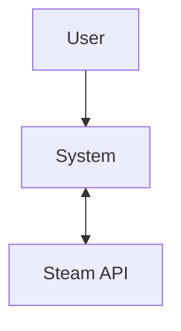
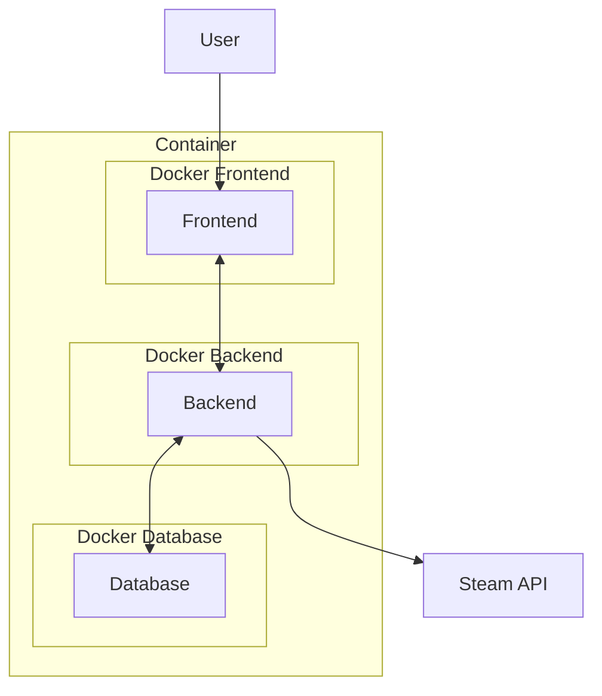
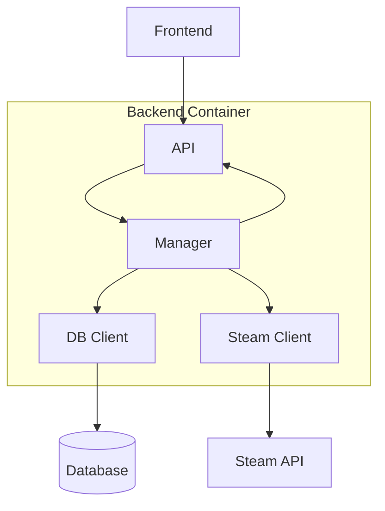

# Steam Player Count Tracker Architecture

## Context Diagram
This diagram shows the interaction between the user, the Steam Player Count Tracker system, and the external Steam API.

## Container Diagram
This diagram shows the deployment structure of the application. The system consists of three separate Docker containers for the frontend, backend, and database.

## Component Diagram
This diagram shows the internal structure of the backend container and how the different components communicate with each other and external services.
